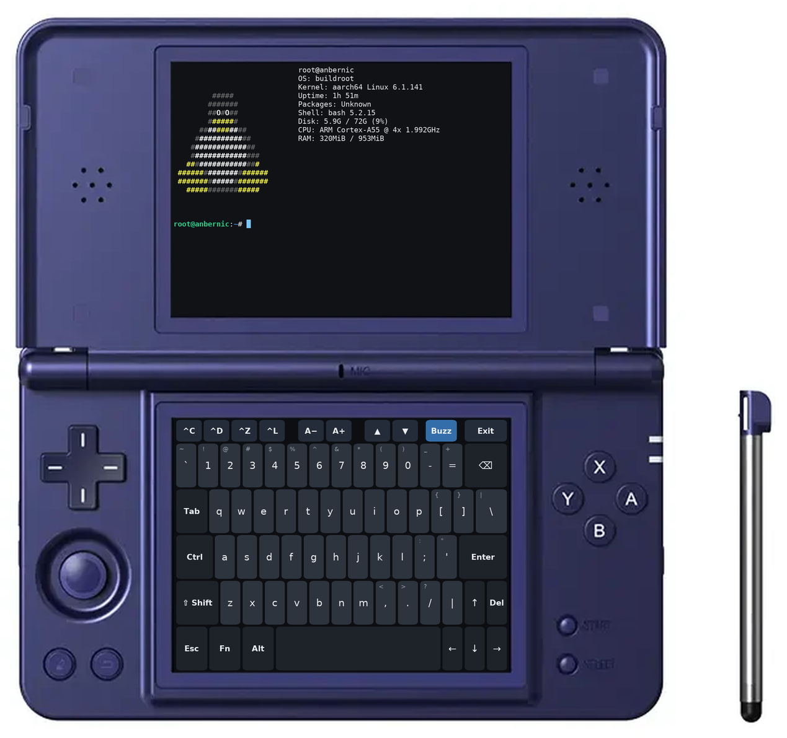

# rgds-terminal

A native terminal app for the **Anbernic RG DS+** dual-screen handheld: a full
bash shell on the top screen and a touch keyboard on the bottom screen, with
haptic feedback and the built-in buttons mapped to useful keys.

<p align="center">
  
</p>

## Features

- **A real terminal.** xterm-compatible emulation (via [libvterm](https://www.leonerd.org.uk/code/libvterm/)),
  so full-screen programs like `vi`, `top` and `less` work. 256 colours and
  truecolor; bold, italic, underline and strikethrough; Unicode including
  Chinese, Japanese and Korean text.
- **Touch keyboard.** A full layout with Shift, Ctrl, Alt and Fn (F1–F12,
  PgUp/PgDn, Home/End), key repeat, and a toolbar for common shortcuts.
- **Haptic feedback.** Each key press gives a short buzz from the rumble motor,
  and so does the terminal bell. It can be turned off.
- **Hardware buttons.** The D-pad gives arrow keys, A/B/X/Y give Enter, Backspace,
  Tab and Ctrl+C, and the shoulder buttons scroll and change the text size.
- **2,000 lines of scrollback** and **adjustable text size**, which is remembered
  between sessions.
- **Small and native.** One 290 KB program written in C. It uses only libraries that
  are already on the device.

## Compatibility

Tested on the **RG DS+** with its stock firmware (Buildroot 2024.02, Linux 6.1).
It should also run on the original RG DS, which uses the same software, but that
hasn't been tested.

## Installation

You need three things from the release: `Terminal.sh`, the `terminal` folder and
`Imgs/Terminal.png`. They go in the `Roms/APPS` folder next to the stock apps
(Clock, System Settings and so on).

### Option 1: copy to the SD card

1. Download `rgds-terminal.zip` from the [Releases](../../releases) page, or
   [build it yourself](#building-from-source).
2. Turn the device off and put the **TF1** card (the system card, in slot 1) in
   your computer.
3. Open the `Roms/APPS` folder on the card and extract the zip into it. You should end up with:
   ```
   Roms/APPS/Terminal.sh
   Roms/APPS/Imgs/Terminal.png
   Roms/APPS/terminal/dsterm
   Roms/APPS/terminal/bashrc
   Roms/APPS/terminal/terminfo/...
   ```
4. Put the card back, turn the device on and open **Apps → Terminal**.

> The `Roms/APPS` folder on the TF2 card is also listed in Apps, so installing
> there should work too, but only TF1 has been tested.

### Option 2: copy over Wi-Fi (SSH)

If SSH is enabled on the device and you know its IP address, run this from a
clone of this repository:

```bash
scripts/deploy.sh root@<device-ip>
```

Replace `<device-ip>` with your device's IP address. This copies the app to
`/mnt/mmc/Roms/APPS` on the device. You can also copy the same files with `scp`.

## Using it

Start it from **Apps → Terminal**. To quit, type `exit`, tap **Exit** twice, or
press **SELECT + START**.

### Touch keyboard

| Key | What it does |
|---|---|
| **Shift, Ctrl, Alt, Fn** | Tap once: applies to the next key (the key turns blue). Double-tap: locks it on (orange). Tap again to release. |
| **Fn layer** | The number row becomes F1–F12, ↑/↓ become PgUp/PgDn, ←/→ become Home/End, and ⌫ becomes Delete. |
| Holding a key | Repeats it: letters, Backspace, Delete, Space and the arrows. |

The toolbar along the top:

| Button | What it does |
|---|---|
| **^C ^D ^Z ^L** | Ctrl+C (interrupt), Ctrl+D (end of input), Ctrl+Z (suspend), Ctrl+L (clear screen) |
| **A− A+** | Smaller or larger text |
| **▲ ▼** | Scroll back and forward through earlier output |
| **Buzz** | Haptic feedback on (blue) or off |
| **Exit** | Tap twice to quit. The first tap gives a long buzz and shows “Sure?” |

A USB or Bluetooth keyboard should also work alongside the touch keyboard, but
this hasn't been tested.

### Buttons

| Button | Action |
|---|---|
| D-pad | Arrow keys |
| A | Enter |
| B | Backspace |
| X | Tab (completion) |
| Y | Ctrl+C |
| L1 / R1 | Scroll back / forward |
| L2 / R2 | Smaller / larger text |
| SELECT + START | Quit |

### Good to know

- The shell is bash, started in `/root`. It reads `/etc/profile` and then your
  `~/.bashrc`, so you can customise your prompt and aliases there.
- The text size and the Buzz setting are saved in `Roms/APPS/terminal/settings.conf`.
- If the app doesn't start, look in `Roms/APPS/terminal/log.txt`.

## Building from source

The device has no compiler, so the app is built in an arm64 Debian 12 container
using [Podman](https://podman.io/). Debian 12's C library is older than the
device's, so the program it builds runs on the device.

```bash
scripts/build.sh                    # builds app/terminal/dsterm
scripts/deploy.sh root@<device-ip>  # installs it over SSH
scripts/package.sh                  # builds dist/rgds-terminal.zip for a release
```

A machine with an arm64 CPU (Apple Silicon Mac or arm64 Linux) builds natively.
On an x86 machine, Podman has to emulate arm64, which needs QEMU user-mode
emulation set up and is much slower.

### Testing tools

These environment variables make it possible to test the app over SSH without
touching the device:

| Variable | Effect |
|---|---|
| `DSTERM_INPUT` | Types this text into the shell 1.5 s after start. `\r` is Enter. |
| `DSTERM_SNAPSHOT` | Saves both screens as `top.bmp` and `bottom.bmp` in this folder… |
| `DSTERM_SNAPSHOT_AT` | …this many seconds after start (default 4). |
| `DSTERM_SWAP` | `1` swaps the top and bottom screens. |

`scripts/screenshot.sh` uses them to capture both screens from the device.
`scripts/mockup.py` places a pair of captures onto `docs/device.png`, which is
how the image at the top of this README was made. `scripts/colortest.sh` prints
text styles, the colour palettes and some Unicode, for checking the rendering.

## How it works

Things about the device that shaped the design:

- **Two screens.** The stock firmware runs the Weston Wayland compositor with the two
  1024×768 panels as separate outputs. The app opens one fullscreen SDL2 window on
  each.
- **Touch input.** Touches on the bottom panel are reported to the *top* window, with
  coordinates covering the bottom panel. The app only uses the position, so it
  doesn't matter which window receives them.
- **Drawing.** Using render-target textures in one window corrupts the other
  window's output on this GPU driver. The terminal therefore draws straight to the
  screen and only redraws when something changed.
- **Buttons and rumble.** Both come from the `ANBERNIC-rk3568-keys` input device. The
  buttons are read directly from it, as the stock apps do. Haptics are uploaded to
  it as short force-feedback rumble effects. The `moto` switch in sysfs didn't drive
  the motor in testing.
- **Launch script.** `Terminal.sh` makes sure the bottom screen and its touch panel
  are on, and restores the touch setting afterwards.
- **Terminal definition.** The firmware has no `xterm-256color` entry in its terminal
  database, so the app ships one in `terminal/terminfo`.

## Project layout

```
app/                  Files that go in Roms/APPS on the device
  Terminal.sh         Launcher shown in the Apps menu
  Imgs/Terminal.png   Menu icon
  terminal/           Program, shell startup file and terminal definition
src/                  C source
  main.c              Shell process, input handling and main loop
  term.c              Terminal emulation (libvterm), scrollback, top screen
  keyboard.c          Touch keyboard layout, modifiers, bottom screen
  device.c            Hardware buttons and rumble motor
  text.c              Text rendering cache
third_party/          libvterm 0.3.3, compiled into the app
build/Containerfile   Build environment
scripts/              Build, deploy, package, screenshot, mockup and colour-test scripts
docs/                 The README image and the device picture used to make it
```

## Credits

- [libvterm](https://www.leonerd.org.uk/code/libvterm/) by Paul Evans (MIT licence),
  included in `third_party/`.
- The `xterm-256color` terminal definition comes from the ncurses terminfo database.
- Text uses the DejaVu and Source Han Sans fonts that ship with the device's
  firmware. They are not included in this repository.
